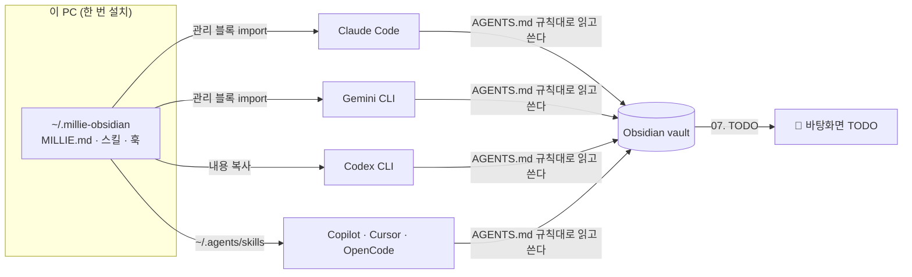

<div align="center">

<h1>Millie Obsidian Kit</h1>

<p><b>한 번 설치하면, 이 PC의 모든 AI 코딩 에이전트가 같은 vault 규칙으로 일한다.</b><br>
할 일은 바탕화면에 블록으로 쌓이고, 끝내면 빠진다.</p>

<p>


</p>

<p>
<a href="#-빠른-시작">빠른 시작</a> ·
<a href="#-바탕화면-todo">바탕화면 TODO</a> ·
<a href="#-동작-방식">동작 방식</a> ·
<a href="#-스킬">스킬</a> ·
<a href="#-자주-묻는-것">자주 묻는 것</a>
</p>


<sub>바탕화면 TODO — 예시 데이터. 오래될수록 · 마감이 지날수록 블록이 커지고, 작은 블록이 더 높이 쌓인다.</sub>

</div>

<br>

> [!NOTE]
> **Obsidian 커뮤니티 플러그인이 아니다.** `.obsidian/plugins/` 에 넣는 물건이 아니라, **PC 당 한 번** `~/.millie-obsidian` 에 설치하는 AI 에이전트 프레임워크다. 연결되는 vault 는 `config.json` 의 `vault` 하나.
> AI 에이전트에게 설치를 시킬 때는 [`AGENTS.md`](AGENTS.md) 를 먼저 읽게 하라.

## ✨ 무엇을 하나

| | |
|---|---|
| 🧠 **어디서든 같은 지침** | Claude Code · Codex · Gemini 등 이 PC 의 모든 에이전트가, 어느 작업 폴더에서든 같은 전역 지침과 스킬을 읽는다 |
| 🧱 **바탕화면 TODO** | 할 일이 블록이 되어 바탕화면에 떨어져 쌓인다. 끌고, 오른쪽 클릭으로 Claude 를 열어 바로 해결한다 |
| 📝 **끝난 그 자리에서 기록** | 작업 · 마일스톤 · 결정을 끝낸 같은 턴에 vault 에 바로 쓴다 — 개발일지 한 줄, 마일스톤 체크, 할 일 |
| 🧭 **정책 · 용어 스킬** | 코드에 흩어진 정책을 영역별로 전수 추출하고, 용어집을 같은 규칙으로 쌓는다 |
| 🛡️ **프로젝트 가드** | 완료 조건 · 마일스톤 · 완료일이 비면 일이 오갈 때마다 리마인드. 할 일은 중요도 · 마감 · 난이도 없이 못 넣는다 |

## 🚀 빠른 시작

**필요한 것**: macOS · Python 3 · Xcode Command Line Tools(`swiftc`, 바탕화면 TODO 빌드용) · Obsidian · Claude Code(선택)

```bash
git clone https://github.com/phantomMillie/millie-obsidian-kit.git ~/.millie-obsidian
cd ~/.millie-obsidian
./install.sh --init          # 새 vault 를 ~/.millie-obsidian/vault 에 만들면서 설치
```

이미 vault 가 있으면 `cp config.example.json config.json` → `"vault"` 를 그 경로로 → `./install.sh`.

`install.sh` 한 번이면 끝난다 — 전역 지침 연결, 스킬 링크, Claude Code 플러그인 등록, Templater · Dataview 설치와 vault 등록, 바탕화면 TODO 빌드 · 자동 실행까지. 여러 번 돌려도 결과가 같고, `./install.sh --remove` 로 연결만 걷어낸다(레포 파일과 vault 는 남는다).

## 🧱 바탕화면 TODO

`plugin/tools/todo-pile` — vault 의 최신 `07. TODO` 파일을 읽어, 할 일을 블록으로 바탕화면(폴더 아이콘 위, 앱 창 아래)에 떨어뜨린다. SpriteKit 물리로 기울고 구르며 쌓이고, 다 쌓이면 그리기를 멈춘다(CPU 0).

- **급할수록 크게** — 오래될수록 · 마감이 다가오거나 지날수록 · 중요할수록 · 미룰수록 글자가 커지고, 작은 메아리 블록이 늘어 더 높이 쌓인다
- **마감 배지** — 차분한 알약으로 `3일 지남` · `오늘까지` · `내일까지` · `2일 남음`. 지남 · 오늘 · 내일 카드는 왼쪽에 가는 색 띠
- **왼쪽 클릭** — 잡고 끌기, 놓으면 던져진다
- **오른쪽 클릭** — Claude 로 해결하기(모델 고르기, 엔터 = Opus) · AI 로 수정하기 · 완료 · 마감 정하기 · 버리기
- **도구 블록** — `＋ 할 일 쓰기`(내용만 쓰고 엔터) · `🎙 회의하기`(녹음 + 회의록, 저장하면 Claude 가 정리하고 할 일을 뽑는다)
- **Jira** — API 토큰을 넣으면 내게 할당된 이슈도 블록으로. 보여 줄 상태를 고른다
- **메뉴바 `TODO`** — 할 일 목록 · 할 일 추가 · 회의하기 · 새로고침 · 보이기 켜고 끄기
- 프로젝트마다 색이 겹치지 않게, 끝낸 할 일은 빠지고 위가 무너져 내려앉는다

<details>
<summary>할 일 줄 형식</summary>

```markdown
- [ ] ⏭ 09-13 🔸 [프로젝트] 내용 · ❗상 · 📅 2026-10-20 · ↻1
```

`⏭` 처음 생긴 날 · `⚡ 🔸 🧱` 난이도(30분 · 반나절 · 하루 이상) · `❗` 중요도 · `📅` 마감 · `↻` 미룬 횟수. 넣을 때는 `vault_record.py todo` 가 중요도 · 마감 · 난이도를 다 받아야만 받는다. 자세한 건 [`plugin/tools/todo-pile/README.md`](plugin/tools/todo-pile/README.md).

</details>

## 🧠 동작 방식



- **PC 종속** — 한 번 설치하면 어느 AI · 어느 작업 폴더 · 어느 세션에서든 같은 지침과 스킬이 로드된다
- **본체는 표준 포맷** — 방법은 [Agent Skills](https://agentskills.io/specification)(`SKILL.md`), vault 규칙은 vault 루트 `AGENTS.md`. 특정 AI 전용 문법을 본체에 넣지 않는다
- **규칙 원본은 vault 에** — `AGENTS.md`. 스킬은 절차 + 완료 검사만. 규칙이 바뀌면 원본만 고친다

## 🧩 스킬

```
policy-extract  코드 정책 영역별 전수 → ✅/⚠️/🚫 + 파일:라인 + mermaid
glossary-add    용어집 3줄 고정 + 📖 인덱스 갱신
vault-record    작업·마일스톤이 끝난 턴에 vault 에 바로 기록 (개발일지 · 체크 · 할 일 · 영역 · 자료)
vault-init      새 vault 생성 (PARA 폴더 · AGENTS.md · 템플릿 · 점검 스크립트 · 대시보드)
```

## 📚 더 보기

<details>
<summary><b>📁 구조</b></summary>

```
~/.millie-obsidian/             프레임워크 홈 (PC 에 하나)
├── config.json                 vault 경로 — PC 설정 (gitignore)
├── vault/                      vault 본체 (gitignore)
├── MILLIE.template.md          전역 지침 원본 → install.sh 가 MILLIE.md 생성 (gitignore)
├── install.sh                  PC 에 연결 / 해제
├── .claude-plugin/             마켓플레이스 메타 (source: ./plugin)
├── para/                       PARA 수집기 · 분류기
└── plugin/                     Claude Code 가 캐시로 복사해 가는 범위
    ├── .claude-plugin/         플러그인 메타 (스킬 · 훅)
    ├── skills/<이름>/SKILL.md   방법 원본
    ├── hooks/project_guard.py  프로젝트 필수 항목 리마인드 훅
    ├── scripts/                millie_home · vault_init · vault_record · project_lint · bootstrap · obsidian_setup
    ├── tools/todo-pile/        바탕화면 TODO (Swift · SpriteKit)
    └── vault-template/         vault 골격 (회사·개인 데이터 없음)
```

`config.json` 과 vault 는 `plugin/` 밖에 둔다 — 캐시로 복사되지 않게 하려는 것이다.

`install.sh` 가 만드는 연결:

```
~/.claude/CLAUDE.md    ┐
~/.gemini/GEMINI.md    ├─ 관리 블록 → MILLIE.md   (전역 지침: vault 경로 · AGENTS.md 읽기 · 스킬 목록)
~/.codex/AGENTS.md     ┘  (Claude · Gemini 는 import, Codex 는 내용 복사)
~/.agents/skills/*     → plugin/skills/*            (Codex · Gemini CLI · Copilot · Cursor · OpenCode)
Claude Code 플러그인    → millie-vault@millie-obsidian
~/Library/LaunchAgents → com.millie.todo-pile       (바탕화면 TODO 자동 실행)
```

관리 블록(`<!-- millie-obsidian:start/end -->`) 밖 내용은 건드리지 않는다. 여러 번 돌려도 블록은 하나.

</details>

<details>
<summary><b>⚙️ 설정 — <code>config.json</code></b></summary>

vault 마다 다른 값은 전부 여기. 코드 · 스킬에는 `<키>` 만 있고, 실행할 때 `<vault>/<paths.키>` 로 읽는다. gitignore — 이 PC 에만 있다. 형식은 `config.example.json`.

```
vault                 vault 절대 경로
paths.projects ...    PARA 폴더 (projects · areas · resources · archives · store)
paths.glossary        용어집 폴더 · glossary_index 인덱스 (glossary-add)
paths.policy_index    정책 인덱스 문서                    (policy-extract)
paths.para_inbox      PARA 인박스 · para_history 이동 히스토리
paths.devlog_inbox    분류기가 프로젝트 사건을 넘길 인박스 · issue_inbox 이슈용
paths.keyword_rules   키워드 규칙 JSON (선택, LLM 힌트)
paths.spec_doc        PARA 규격서 (선택, 인박스 머리말 링크)
classify.*            폴백 프로젝트 이름 · 자료 주제에서 뺄 폴더
local.*               API 키 · LLM 명령 · Slack 웹훅 파일 위치 (vault 밖)
```

</details>

<details>
<summary><b>📝 실시간 기록 — <code>vault_record.py</code></b></summary>

AI 가 작업 · 마일스톤 · 결정을 끝냈다고 보고하는 **같은 턴**에 vault 에 바로 쓴다. SessionStart 훅이 이 규칙과 프로젝트 목록을 주입하고, `vault-record` 스킬이 절차를 갖는다.

| 하는 일 | 효과 |
|---|---|
| `devlog` | `<프로젝트> 개발일지/오늘.md` 의 한 일 · 결정 · 이슈 · 외부 · 로그에 한 줄 |
| `todo` | 오늘 `07. TODO` 에 할 일 — 중요도 · 마감 · 난이도 필수. 바탕화면 TODO 가 이 값으로 쌓는다 |
| `tick` | 마일스톤 · 세부 목표 · 완료 조건 체크 → 대시보드 진행률에 즉시 반영 |
| `area` · `resource` | 영역 메모 · 자료 수집 노트에 한 줄 (이미 있는 것만) |

기록 대상은 **Projects / Areas / Resources / Archives / Store(임시로 밀린 것) 중 정확히 한 곳** — PARAS. 기존 파일에 한 줄 추가 · 체크만 하고, `due` · 날짜 · 완료 조건 문구는 안 고치고 제안만 한다. 같은 줄은 한 번만 남고, 비밀 문자열은 가려진다.

**폴더 생성 · 보관은 사용자 허락 후에만.** 기존에서 먼저 찾고(`match`), 정말 없을 때만 묻는다. 허락 전엔 `00. 미분류` 로그에 임시 기록한다. 프로젝트는 `new project --name … --due … --done … --milestone … --approved` — 완료일 · 완료 조건 · 마일스톤이 없으면 거부한다(나중에 정하겠다고 할 때만 `--scope-later`). 끝난 프로젝트는 `archive`, 임시로 밀린 프로젝트는 `shelve`(→ Store) · 다시 하면 `resume`. `--approved` 없이는 스크립트가 거부한다.

</details>

<details>
<summary><b>🛡️ 프로젝트 필수 항목 가드</b></summary>

활성 프로젝트는 **완료 조건 · 마일스톤(날짜) · 완료일(`due`)** 이 있어야 한다. 비어 있으면 일이 오가는 동안 계속 리마인드한다. 점검 로직(`plugin/scripts/project_lint.py`)은 플러그인이 원본이고, vault-init 이 vault `.scripts/` 에 사본을 둔다.

| 경로 | 언제 |
|---|---|
| `plugin/hooks/project_guard.py` SessionStart | 세션 시작에 빈 프로젝트 요약 (최대 5개) |
| `plugin/hooks/project_guard.py` UserPromptSubmit | 프롬프트에 프로젝트 이름이 나오면 세션당 1번 상기 |
| vault `devlog_check.py` (Slack, 선택) | 최근 일지가 있는 프로젝트가 비었으면 `추가 검토사항` 에 |
| vault `📓 Projects` 대시보드 | `필수 항목` 열 |

채우기는 vault 의 `/obsidian-project-scope <이름>`.

</details>

<details>
<summary><b>🗂️ PARA 수집기 · 분류기</b></summary>

`para/collect.py` — AI 도구 대화 기록에서 **끝난 사건**만 골라 `<para_inbox>` 에 쌓는다. 자동화 세션(`claude -p` · `codex exec`)은 건너뛴다.

Claude Code 세션이 시작될 때 훅이 3시간에 한 번 뒤에서 LLM 없이 줍고(`--no-llm`), 인박스에 3건 넘게 쌓이면 AI 가 예시를 붙여 **"지난 대화에서 끝난 일 N건이 아직 vault 에 정리 안 됐어요 — 예: 「…」. 맞는 곳에 나눠 넣을까요?"** 하고 묻는다. 승낙하면 그때 `classify.py` 를 돌린다 — 분류(LLM)는 묻지 않고 돌리지 않는다.

```bash
python3 para/collect.py --dry-run     # 결과만 출력
python3 para/collect.py               # 적립 (최근 24시간, 최대 20세션)
python3 para/collect.py --no-llm      # LLM 없이 끝 신호 기준 세션 단위
```

`para/classify.py` — 인박스의 사건을 규칙 → LLM → 폴백으로 보낸다.

- 프로젝트 → `<devlog_inbox>` · `<issue_inbox>` 에 `[프로젝트|섹션] 원문` 으로 넘김 → 분배 배치가 개발일지 · 이슈 · 할 일에 넣는다
- Areas → `<areas>/🧵 <영역>.md` `## 🧠 메모` (없으면 PARA 인박스에 승인 체크박스)
- Resources → `<resources>/<주제>/📎 <주제> 수집.md`

```bash
python3 para/classify.py --dry-run    # 판단만
python3 para/classify.py --no-slack   # 분류 (Slack 없이)
```

외부 LLM 은 `para/llm.py` 의 `llm_allowed()` 가 허용할 때만 (API 키 또는 Claude Team · Enterprise).

</details>

<details>
<summary><b>✅ 도구별 확인 상태 (2026-10-08)</b></summary>

| 도구 | 전역 지침 | 스킬 |
|---|---|---|
| Claude Code | `/tmp` 새 세션에서 vault 경로 답함 ✅ | 플러그인 등록 ✅ |
| Codex CLI 0.153.4 | `/tmp` 새 세션에서 vault 경로 답함 ✅ | 인식 ✅ |
| Gemini CLI 0.59.0 | 미확인 — 계정 티어 문제로 모델 호출 불가 | `gemini skills list` ✅ |
| Copilot · Cursor · OpenCode | 미설치 | 문서상 `~/.agents/skills` 지원 |

</details>

## ❓ 자주 묻는 것

<details>
<summary><b>vault 를 다른 자리에 두고 싶다</b></summary>

`./install.sh --init <폴더>` 로 처음부터 그 자리에 만들거나, 이미 있는 vault 면 `config.json` 의 `vault` 를 고치고 `./install.sh` 를 다시 돌린다.

</details>

<details>
<summary><b>바탕화면 TODO 만 끄고 싶다</b></summary>

메뉴바 `TODO` → `바탕화면에 블록 보이기` 를 끈다. 아예 안 깔려면 `./install.sh --no-todo-pile`.

</details>

<details>
<summary><b>스킬 · 훅을 고쳤는데 반영이 안 된다</b></summary>

Claude Code 는 `plugin/` 을 캐시로 복사해서 돌린다. 고친 뒤 `./install.sh` 를 다시 돌리면 반영된다.

</details>

<details>
<summary><b>vault 관리 파일을 최신으로 맞추고 싶다</b></summary>

`python3 plugin/scripts/vault_init.py <vault> --update` — 점검 스크립트 · 커맨드만 갱신한다(`.bak` 백업, 나머지는 안 건드림).

</details>

## 🗺️ 다음 층

- 가드 확장 — 파일명 · 프론트매터 린트 + PC 단위 실행(launchd 감시 / git pre-commit)
- 이력 — git 자동 커밋 · 규격서 변경 이력
- 흐름 — vault `.claude/` 운영 커맨드(devlog · jira · weekly 등) 이관
