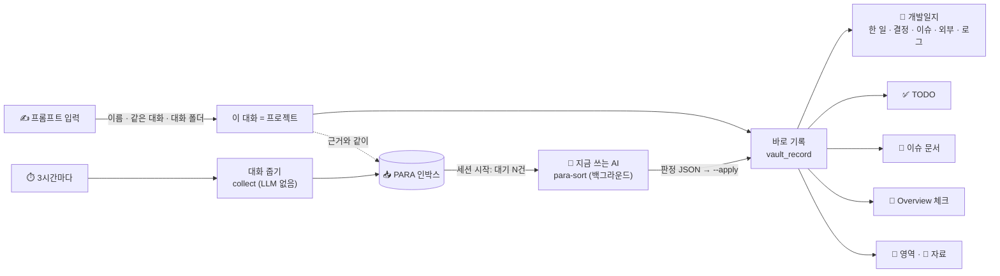
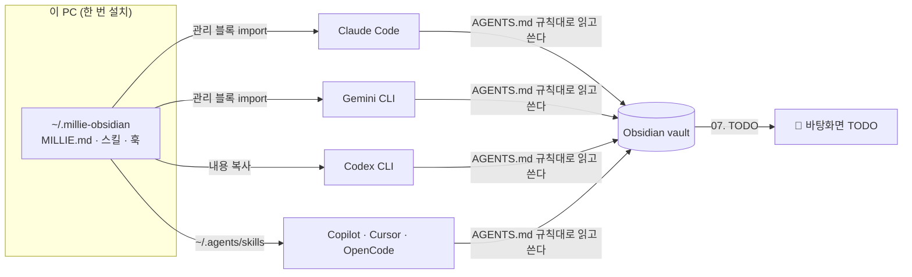

<div align="center">

<h1>Millie Obsidian Kit</h1>

<p><b>한 번 설치하면, 이 PC의 모든 AI 코딩 에이전트가 같은 vault 규칙으로 일한다.</b><br>
할 일은 바탕화면에 블록으로 쌓이고, 끝내면 빠진다.</p>

<p>


</p>

<p>
<a href="#-빠른-시작">빠른 시작</a> ·
<a href="#-바탕화면-todo">바탕화면 TODO</a> ·
<a href="#para">알아서 PARA 정리</a> ·
<a href="#-동작-방식">동작 방식</a> ·
<a href="#-스킬">스킬</a> ·
<a href="#-자주-묻는-것">자주 묻는 것</a>
</p>


<sub>바탕화면 TODO — 예시 데이터. 오래될수록 · 마감이 지날수록 블록이 커지고, 작은 블록이 더 높이 쌓인다.</sub>

</div>

<br>

> [!NOTE]
> **Obsidian 커뮤니티 플러그인이 아니다.** `.obsidian/plugins/` 에 넣는 물건이 아니라, **PC 당 한 번** `~/.millie-obsidian` 에 설치하는 AI 에이전트 프레임워크다. 연결되는 vault 는 `config.json` 의 `vault` 하나.
> AI 에이전트에게 설치를 시킬 때는 [`AGENTS.md`](AGENTS.md) 를 먼저 읽게 하라.

## ✨ 무엇을 하나

| | |
|---|---|
| 🧠 **어디서든 같은 지침** | Claude Code · Codex · Gemini 등 이 PC 의 모든 에이전트가, 어느 작업 폴더에서든 같은 전역 지침과 스킬을 읽는다 |
| 🧱 **바탕화면 TODO** | 할 일이 블록이 되어 바탕화면에 떨어져 쌓인다. 끌고, 오른쪽 클릭으로 Claude 를 열어 바로 해결한다 |
| 📝 **끝난 그 자리에서 기록** | 작업 · 마일스톤 · 결정을 끝낸 같은 턴에 vault 에 바로 쓴다 — 개발일지 한 줄, 마일스톤 체크, 할 일 |
| 🗂️ **알아서 PARA 정리** | 프롬프트를 입력할 때 어느 프로젝트 일인지 정하고, 지난 대화에서 놓친 끝난 일은 **지금 쓰는 AI** 가 뒤에서 판정해 개발일지 · TODO · 이슈 · 영역 · 자료에 넣는다. API 키 없이, 묻지 않고 |
| 🧭 **정책 · 용어 스킬** | 코드에 흩어진 정책을 영역별로 전수 추출하고, 용어집을 같은 규칙으로 쌓는다 |
| 🛡️ **프로젝트 가드** | 완료 조건 · 마일스톤 · 완료일이 비면 일이 오갈 때마다 리마인드. 할 일은 중요도 · 마감 · 난이도 없이 못 넣는다 |

## 🚀 빠른 시작

**필요한 것**: macOS · Python 3 · Xcode Command Line Tools(`swiftc`, 바탕화면 TODO 빌드용) · Obsidian · Claude Code(선택)

```bash
git clone https://github.com/phantomMillie/millie-obsidian-kit.git ~/.millie-obsidian
cd ~/.millie-obsidian
./install.sh --init          # 새 vault 를 ~/.millie-obsidian/vault 에 만들면서 설치
```

이미 vault 가 있으면 `cp config.example.json config.json` → `"vault"` 를 그 경로로 → `./install.sh`.

`install.sh` 한 번이면 끝난다 — 전역 지침 연결, 스킬 링크, Claude Code 플러그인 등록, Templater · Dataview 설치와 vault 등록, 바탕화면 TODO 빌드 · 자동 실행까지. 여러 번 돌려도 결과가 같고, `./install.sh --remove` 로 연결만 걷어낸다(레포 파일과 vault 는 남는다).

## 🧱 바탕화면 TODO

`plugin/tools/todo-pile` — vault 의 최신 `07. TODO` 파일을 읽어, 할 일을 블록으로 바탕화면(폴더 아이콘 위, 앱 창 아래)에 떨어뜨린다. SpriteKit 물리로 기울고 구르며 쌓이고, 다 쌓이면 그리기를 멈춘다(CPU 0).

- **급할수록 크게** — 오래될수록 · 마감이 다가오거나 지날수록 · 중요할수록 · 미룰수록 글자가 커지고, 작은 메아리 블록이 늘어 더 높이 쌓인다
- **마감 배지** — 차분한 알약으로 `3일 지남` · `오늘까지` · `내일까지` · `2일 남음`. 지남 · 오늘 · 내일 카드는 왼쪽에 가는 색 띠
- **왼쪽 클릭** — 잡고 끌기, 놓으면 던져진다
- **오른쪽 클릭** — Claude 로 해결하기(모델 고르기, 엔터 = Opus) · AI 로 수정하기 · 완료 · 마감 정하기 · 버리기
- **도구 블록** — `＋ 할 일 쓰기`(내용만 쓰고 엔터) · `🎙 회의하기`(녹음 + 회의록, 저장하면 Claude 가 정리하고 할 일을 뽑는다)
- **Jira** — API 토큰을 넣으면 내게 할당된 이슈도 블록으로. 보여 줄 상태를 고른다
- **메뉴바 `TODO`** — 할 일 목록 · 할 일 추가 · 회의하기 · 새로고침 · 보이기 켜고 끄기
- 프로젝트마다 색이 겹치지 않게, 끝낸 할 일은 빠지고 위가 무너져 내려앉는다

<details>
<summary>할 일 줄 형식</summary>

```markdown
- [ ] ⏭ 09-13 🔸 [프로젝트] 내용 · ❗상 · 📅 2026-10-20 · ↻1
```

`⏭` 처음 생긴 날 · `⚡ 🔸 🧱` 난이도(30분 · 반나절 · 하루 이상) · `❗` 중요도 · `📅` 마감 · `↻` 미룬 횟수. 넣을 때는 `vault_record.py todo` 가 중요도 · 마감 · 난이도를 다 받아야만 받는다. 자세한 건 [`plugin/tools/todo-pile/README.md`](plugin/tools/todo-pile/README.md).

</details>

<a id="para"></a>

## 🗂️ 알아서 PARA 정리

끝난 일은 vault 의 다섯 곳 중 **정확히 한 곳**으로 가고, 프로젝트 일이면 그 안에서 다시 **개발일지 · TODO · 이슈 · 마일스톤**으로 쪼개진다. 무엇을 어디에 둘지는 **지금 쓰고 있는 그 AI 가 판단한다** — API 키도, 따로 부르는 LLM 도 없다. 그 AI 는 이미 대화를 본 당사자라 대화를 다른 곳으로 더 보내지 않는다. 스크립트는 줍고 · 보여 주고 · 쓰기만 한다. 새 폴더 · 이동은 꼭 묻고, 어디로 갔는지는 늘 남는다.

길은 둘이다.

- **바로 기록** — 일이 끝난 그 턴에 AI 가 `vault_record.py` 로 직접 쓴다
- **뒤에서 정리** — 지난 AI 대화에서 끝난 일을 주워 두면(3시간에 한 번, LLM 없음), 다음 세션에서 그 AI 가 백그라운드 에이전트로 `para-sort` 스킬을 따라 판정하고 쓴다. 바로 기록을 놓친 일까지 여기서 잡힌다



### 어디로 가나 — 다섯 곳

| 곳 | 무엇 | 써지는 곳 |
|---|---|---|
| **Projects** | 끝이 있는 일 (완료 조건 · 기한) | 개발일지 · TODO · 이슈 · Overview 로 쪼개진다 — [아래](#split) |
| **Areas** | 끝이 없는 책임 (보안 점검 · 팀 운영) | `2. Areas/🧵 <영역>.md` 의 `## 🧠 메모` 에 한 줄 |
| **Resources** | 나중에 찾아볼 참고 자료 · 정책 | `3. Resources/<주제>/📎 <주제> 수집.md` 에 한 줄 |
| **Archives** | 완전히 끝난 프로젝트 | 프로젝트 폴더째 `4. Archives/` 로 (이동 — 묻는다) |
| **Store** | 지금은 못 하고 밀린 프로젝트 | 프로젝트 폴더째 `5. Store/` 로 (이동 — 묻는다). 여기엔 기록하지 않는다 |

판정 순서: 끝이 있나 → Projects / 지속 책임 → Areas / 참고용 → Resources / 끝났나 → Archives / 밀린다 → Store.

**기록하지 않는 것** — 잡담 · 말 다듬기 같은 일회성 부탁, 상태 확인 · 목록 조회 · 설명만 듣고 끝난 질문, 그 턴에 이미 바로 기록한 일. **아직 안 끝난 일**(고치는 중, 사용자가 결과를 아직 확인 안 함)은 인박스에 `보류` 로 남겨 다음 정리 때 다시 본다.

<a id="split"></a>

### 프로젝트 안에서 쪼개기 — 개발일지 · TODO · 이슈 · 마일스톤

| 생긴 것 | 들어가는 곳 | 바로 기록 | 뒤에서 정리 |
|---|---|:---:|:---:|
| 실제로 한 작업 | 개발일지 `### 한 일` | ✅ | ✅ |
| 정한 것 | 개발일지 `### 결정` | ✅ | ✅ |
| 버그 · 막힘의 원인과 해결 | 개발일지 `### 이슈` | ✅ | ✅ |
| 다른 팀 · 외부 요청 | 개발일지 `### 외부` | ✅ | ✅ |
| 그 밖의 기록 | 개발일지 `## 로그` (시각 `HH:MM` 이 붙는다) | ✅ | ✅ |
| 아직 안 풀린 문제 | `🚨 <프로젝트> 이슈.md` — 프로젝트 · 정책 · 일정 이슈 | ✅ | ✅ |
| 앞으로 할 일 | TODO `## 할 것` | ✅ 중요도 · 마감 · 난이도 셋 다 받아야 | ✅ 난이도만 (물을 사람이 없다) |
| 마일스톤 · 세부 목표 · 완료 조건 달성 | `📓 <프로젝트> Overview.md` 체크 (진행률 반영) | ✅ | — |

- **파일** — 개발일지는 `3. Resources/03. 개발일지/<프로젝트> 개발일지/<오늘>.md`, TODO 는 `3. Resources/07. TODO/<오늘>.md`. 없으면 그날 처음 쓸 때 만든다. 이슈 문서는 프로젝트를 만들 때 같이 생긴다 — 없으면 새로 만들지 않고 개발일지에만 남긴다
- **한 사건이 여러 곳으로** — 예: "iOS 크래시 고쳤는데 안드로이드는 재현이 안 됨" → 개발일지 `이슈` 한 줄 + 🚨 이슈 문서 체크박스 + TODO 한 줄
- **한 대화에 여러 일** — 프로젝트가 다르면 각 프로젝트로, 같은 프로젝트의 다른 일이면 줄을 따로
- **할 일 한 줄** — `- [ ] 🔸 [프로젝트] 내용 · ❗중 · 📅 2026-10-20`. 바로 기록 때 중요도 · 마감 · 난이도(⚡ 30분 · 🔸 반나절 · 🧱 하루 이상) 중 하나라도 없으면 스크립트가 거부하고, AI 가 사용자에게 먼저 묻는다(지어내지 않는다). 바탕화면 TODO 블록이 이 줄을 읽는다
- **못 끝낸 할 일** — 다음 날 파일로 넘어간다. `⏭ 10-15` = 처음 생긴 날
- **같은 줄** — 이미 있으면 건너뛴다. 기존 줄을 지우거나 고쳐 쓰지 않는다

### 언제 무엇이 일어나나

| 언제 | 누가 | 하는 일 | 사용자에게 보이는 것 |
|---|---|---|---|
| Claude Code 세션 시작 · 재개 · 압축 뒤 | 훅 | 규칙 · 프로젝트 목록을 AI 에게 준다. 3시간이 지났으면 대화 줍기를 뒤에서 시작한다 | 없음 (조용히) |
| 〃 (정리 대기가 있으면) | 지금 쓰는 AI | 첫 응답 때 백그라운드 에이전트를 띄워 `para-sort` — 판정하고 쓴다. 다른 대화가 정리 중이면 건너뛴다(잠금) | 끝나면 `PARA 정리 기록 N · 건너뜀 N · 보류 N · 승인 대기 N` 한 줄 |
| 프롬프트 입력 | 훅 | 이 대화의 프로젝트를 정한다 (아래). 처음 정했거나 바뀌었을 때만 AI 에게 알린다 | 없음 — AI 가 그 프로젝트로 기록한다 |
| 일이 끝난 그 턴 | AI | `vault_record.py` 로 개발일지 · TODO · 이슈 · Overview 체크 | 답 끝에 `기록: <프로젝트> ▸ <섹션>` 한 줄 (체크했으면 `체크: <항목> (n/m)`) |

### 프로젝트는 어떻게 정하나

프롬프트를 입력할 때 LLM 없이 이 순서로 정한다.

1. **프롬프트에 프로젝트 이름**이 있으면 그것 — 다른 프로젝트 일로 바꾸고 싶을 때도 이름만 말하면 된다
2. **같은 대화에서 앞서 정한 것**
3. **대화를 연 폴더** — 코드 폴더 ↔ 프로젝트 연결. 아직 어느 프로젝트에도 안 묶인 폴더에서 이름으로 정하면 그 폴더를 배워서, 다음부터는 이름 없이도 정해진다

**폴더와 이름이 다르면** — 예: Y 폴더에서 "결제 모듈 README 처럼 정리해줘" — 이름이 지나가듯 나온 것일 수 있다. 그래서 그 폴더를 결제로 배우지 않고, 바로 기록하는 AI 에게 둘 다 알려 실제로 고친 것을 보고 고르게 한다. 사용자가 "이건 결제 일이야" 라고 직접 말하면 그 말이 먼저다.

**전역 대화**(홈 · vault 폴더처럼 어느 프로젝트에도 묶이지 않은 곳 — 이런 폴더는 배우지 않는다)는 프롬프트 때 정해지지 않는다. 그러면

- **바로 기록** — AI 가 내용을 보고 프로젝트 목록에서 고른다. 프로젝트 일이 아니면 영역 · 자료로. 맞는 곳이 없으면 새로 만들지 한 줄로 묻고, 답을 기다리는 동안 `00. 미분류` 개발일지 로그에 `[분류 대기: …]` 로 둔다
- **뒤에서 정리** — AI 가 대화 발췌 · 고친 파일 · 폴더를 보고 고른다. 맞는 프로젝트가 없는 업무는 `미분류`, 새 영역 · 자료 주제가 맞으면 승인 체크박스로 남긴다

### AI 마다 되는 것

전역 지침(`MILLIE.md`)과 스킬(`vault-record` · `para-sort`)은 모든 에이전트가 읽는다. 훅은 Claude Code 에만 있다.

| | Claude Code | Codex | Gemini |
|---|:---:|:---:|:---:|
| 끝난 턴에 바로 기록 (전역 지침 + `vault-record`) | ✅ | ✅ | 지침 읽기 미확인 |
| 뒤에서 정리 (`para-sort`) | ✅ 세션 시작 때 알아서 | ✅ "PARA 정리해줘" 하면 | ✅ "PARA 정리해줘" 하면 |
| 세션 시작 때 규칙 · 프로젝트 목록 받기 (훅) | ✅ | — 스킬의 `projects` 로 본다 | — |
| 프롬프트 때 프로젝트 정하기 (훅) | ✅ | — AI 가 고른다 | — |
| 대화 줍기 대상 | ✅ | ✅ | ✅ 구 형식(`.json`) · 새 형식(`.jsonl`) |

### 묻는 것 · 안 묻는 것

- **묻지 않고 한다** — 이미 있는 파일에 한 줄 추가 · 체크, 뒤에서 정리
- **꼭 묻는다** — 새 프로젝트(완료일 · 완료 조건 · 마일스톤을 같이 묻는다) · 새 영역 · 새 자료 주제 폴더 · Archives / Store 로 옮기기. 뒤에서 정리하다 나온 새 영역 · 주제는 인박스에 승인 체크박스로 남는다
- **안 한다** — 날짜 · 완료 조건 문구 고치기(제안만), 말하지 않은 내용 지어내기(사용자가 말하지 않은 결정 이유 포함), 비밀처럼 보이는 문자열 남기기(가린다)

### 확인하고 고치기

- **어디로 갔나** — vault 루트 `📤 PARA 이동 히스토리.md`. 줄마다 들어간 곳 링크, 건너뛴 것은 이유
- **아직 안 간 것** — vault 루트 `📥 PARA 인박스.md`. `보류`(안 끝남) · 승인 체크박스(새 영역 · 자료 주제 — 체크하면 다음 정리 때 만들고 넣는다)가 여기 남는다
- **틀린 곳으로 갔으면** — 그 줄을 맞는 개발일지로 옮긴다 (틀린 걸 배워서 고치는 기능은 아직 없다)
- **폴더 ↔ 프로젝트 연결** — `state/session-projects.json` 의 `dirs`, 바탕화면 TODO 의 `코드 폴더 바꾸기`

### 스트레스 테스트

```bash
python3 para/tests/stress.py              # 가짜 vault · 가짜 대화 21건으로 줍기 → AI 판정 → 기록 전 과정 + 결정적 점검
python3 para/tests/stress.py --scale 3    # 대상만 다른 같은 유형을 3벌 (63건을 한 번에 판정)
python3 para/tests/stress.py --no-ai      # 판정 없이 줍기 · 훅 · 잠금만 (빠름)
python3 para/tests/stress.py --prepare --out /tmp/s   # 샌드박스만 만들고, 판정은 다른 AI(Codex 등)가 MILLIE_HOME=/tmp/s 로
python3 para/tests/stress.py --score --out /tmp/s     # 그 결과 채점
```

실제 vault · state 는 건드리지 않는다. 잡담 · 확인 질문 · 조회 · 진행 중 · 이름이 지나가듯 나옴 · 한 대화에 두 프로젝트 · 이미 바로 기록함 · 비밀값 · 새 영역 · 긴 잡담 사이의 작업 · 사용자 정정 · Codex · Gemini 새 형식 · 며칠 공백을 케이스로 채점한다. 지금 결과는 판정 21/21 · 3벌 63/63 · 결정적 점검 6/6. 고치기 전 경로(줍기 → 별도 LLM 분류 → 분배 배치)로 같은 케이스를 돌리면 7/17 · 1/3 이었다 — 잡담 · 확인 질문 · 진행 중이 기록되고, 이름이 지나가면 엉뚱한 프로젝트로 갔다.

### 한계

- 대화 줍기는 **Claude Code 세션을 열 때** 3시간이 지났는지 본다. 다른 AI 만 쓰면 "PARA 정리해줘" 로 직접 돌린다(스킬이 줍기부터 한다)
- 정리는 지금 쓰는 AI 가 하므로 그 세션의 사용량을 쓴다 (대기가 있을 때만, 한 번에 모아서)
- 뒤에서 넣은 할 일엔 중요도 · 마감이 없다 — 바탕화면 TODO 에서 `마감 정하기` 로 채운다
- 바로 기록한 일은 대화에 남은 `vault_record` 호출을 보고 거른다. 기록 명령 없이 손으로 적은 건 못 알아본다

## 🧠 동작 방식



- **PC 종속** — 한 번 설치하면 어느 AI · 어느 작업 폴더 · 어느 세션에서든 같은 지침과 스킬이 로드된다
- **본체는 표준 포맷** — 방법은 [Agent Skills](https://agentskills.io/specification)(`SKILL.md`), vault 규칙은 vault 루트 `AGENTS.md`. 특정 AI 전용 문법을 본체에 넣지 않는다
- **규칙 원본은 vault 에** — `AGENTS.md`. 스킬은 절차 + 완료 검사만. 규칙이 바뀌면 원본만 고친다

## 🧩 스킬

```
policy-extract  코드 정책 영역별 전수 → ✅/⚠️/🚫 + 파일:라인 + mermaid
glossary-add    용어집 3줄 고정 + 📖 인덱스 갱신
vault-record    작업·마일스톤이 끝난 턴에 vault 에 바로 기록 (개발일지 · 체크 · 할 일 · 이슈 · 영역 · 자료)
para-sort       지난 대화에서 주운 끝난 일을 지금 쓰는 AI 가 판정해 정리 (기록 여부 · 위치 · 쪼개기)
vault-init      새 vault 생성 (PARA 폴더 · AGENTS.md · 템플릿 · 점검 스크립트 · 대시보드)
```

## 📚 더 보기

<details>
<summary><b>📁 구조</b></summary>

```
~/.millie-obsidian/             프레임워크 홈 (PC 에 하나)
├── config.json                 vault 경로 — PC 설정 (gitignore)
├── vault/                      vault 본체 (gitignore)
├── MILLIE.template.md          전역 지침 원본 → install.sh 가 MILLIE.md 생성 (gitignore)
├── install.sh                  PC 에 연결 / 해제
├── .claude-plugin/             마켓플레이스 메타 (source: ./plugin)
├── para/                       PARA 대화 줍기 · 정리 (tests/stress.py 스트레스 테스트)
└── plugin/                     Claude Code 가 캐시로 복사해 가는 범위
    ├── .claude-plugin/         플러그인 메타 (스킬 · 훅)
    ├── skills/<이름>/SKILL.md   방법 원본
    ├── hooks/project_guard.py  세션 시작 · 프롬프트 훅 — 기록 규칙 · 대화 프로젝트 · 정리 대기 알림 · 필수 항목 리마인드
    ├── scripts/                millie_home · vault_init · vault_record · project_lint · bootstrap · obsidian_setup
    ├── tools/todo-pile/        바탕화면 TODO (Swift · SpriteKit)
    └── vault-template/         vault 골격 (회사·개인 데이터 없음)
```

`config.json` 과 vault 는 `plugin/` 밖에 둔다 — 캐시로 복사되지 않게 하려는 것이다.

`install.sh` 가 만드는 연결:

```
~/.claude/CLAUDE.md    ┐
~/.gemini/GEMINI.md    ├─ 관리 블록 → MILLIE.md   (전역 지침: vault 경로 · AGENTS.md 읽기 · 스킬 목록)
~/.codex/AGENTS.md     ┘  (Claude · Gemini 는 import, Codex 는 내용 복사)
~/.agents/skills/*     → plugin/skills/*            (Codex · Gemini CLI · Copilot · Cursor · OpenCode)
Claude Code 플러그인    → millie-vault@millie-obsidian
~/Library/LaunchAgents → com.millie.todo-pile       (바탕화면 TODO 자동 실행)
```

관리 블록(`<!-- millie-obsidian:start/end -->`) 밖 내용은 건드리지 않는다. 여러 번 돌려도 블록은 하나.

</details>

<details>
<summary><b>⚙️ 설정 — <code>config.json</code></b></summary>

vault 마다 다른 값은 전부 여기. 코드 · 스킬에는 `<키>` 만 있고, 실행할 때 `<vault>/<paths.키>` 로 읽는다. gitignore — 이 PC 에만 있다. 형식은 `config.example.json`.

```
vault                 vault 절대 경로
paths.projects ...    PARA 폴더 (projects · areas · resources · archives · store)
paths.glossary        용어집 폴더 · glossary_index 인덱스 (glossary-add)
paths.policy_index    정책 인덱스 문서                    (policy-extract)
paths.para_inbox      PARA 인박스 · para_history 이동 히스토리
paths.devlog_inbox    (예전 LLM 분류 경로) 프로젝트 사건을 넘길 인박스 · issue_inbox 이슈용
paths.keyword_rules   키워드 규칙 JSON (선택, 예전 LLM 분류 힌트)
paths.spec_doc        PARA 규격서 (선택, 인박스 머리말 링크)
classify.*            폴백 프로젝트 이름 · 자료 주제에서 뺄 폴더
local.*               (선택) API 키 · LLM 명령 — 예전 LLM 분류 경로용 · Slack 웹훅 파일 위치 (vault 밖)
```

</details>

<details>
<summary><b>📝 실시간 기록 — <code>vault_record.py</code></b></summary>

AI 가 작업 · 마일스톤 · 결정을 끝냈다고 보고하는 **같은 턴**에 vault 에 바로 쓴다. SessionStart 훅이 이 규칙과 프로젝트 목록을 주입하고, `vault-record` 스킬이 절차를 갖는다.

| 하는 일 | 효과 |
|---|---|
| `devlog` | `<프로젝트> 개발일지/오늘.md` 의 한 일 · 결정 · 이슈 · 외부 · 로그에 한 줄 |
| `todo` | 오늘 `07. TODO` 에 할 일 — 중요도 · 마감 · 난이도 필수. 바탕화면 TODO 가 이 값으로 쌓는다. 뒤에서 정리할 땐 `--background` (난이도만) |
| `issue` | `🚨 <프로젝트> 이슈.md` 의 프로젝트 · 정책 · 일정 이슈에 안 풀린 문제 체크박스 (문서가 없으면 만들지 않는다) |
| `tick` | 마일스톤 · 세부 목표 · 완료 조건 체크 → 대시보드 진행률에 즉시 반영 |
| `area` · `resource` | 영역 메모 · 자료 수집 노트에 한 줄 (이미 있는 것만) |

기록 대상은 **Projects / Areas / Resources / Archives / Store(임시로 밀린 것) 중 정확히 한 곳** — PARAS. 기존 파일에 한 줄 추가 · 체크만 하고, `due` · 날짜 · 완료 조건 문구는 안 고치고 제안만 한다. 같은 줄은 한 번만 남고, 비밀 문자열은 가려진다.

**폴더 생성 · 보관은 사용자 허락 후에만.** 기존에서 먼저 찾고(`match`), 정말 없을 때만 묻는다. 허락 전엔 `00. 미분류` 로그에 임시 기록한다. 프로젝트는 `new project --name … --due … --done … --milestone … --approved` — 완료일 · 완료 조건 · 마일스톤이 없으면 거부한다(나중에 정하겠다고 할 때만 `--scope-later`). 끝난 프로젝트는 `archive`, 임시로 밀린 프로젝트는 `shelve`(→ Store) · 다시 하면 `resume`. `--approved` 없이는 스크립트가 거부한다.

</details>

<details>
<summary><b>🛡️ 프로젝트 필수 항목 가드</b></summary>

활성 프로젝트는 **완료 조건 · 마일스톤(날짜) · 완료일(`due`)** 이 있어야 한다. 비어 있으면 일이 오가는 동안 계속 리마인드한다. 점검 로직(`plugin/scripts/project_lint.py`)은 플러그인이 원본이고, vault-init 이 vault `.scripts/` 에 사본을 둔다.

| 경로 | 언제 |
|---|---|
| `plugin/hooks/project_guard.py` SessionStart | 세션 시작에 빈 프로젝트 요약 (최대 5개) |
| `plugin/hooks/project_guard.py` UserPromptSubmit | 프롬프트에 프로젝트 이름이 나오면 세션당 1번 상기 |
| vault `devlog_check.py` (Slack, 선택) | 최근 일지가 있는 프로젝트가 비었으면 `추가 검토사항` 에 |
| vault `📓 Projects` 대시보드 | `필수 항목` 열 |

채우기는 vault 의 `/obsidian-project-scope <이름>`.

</details>

<details>
<summary><b>🗂️ PARA 대화 줍기 · 정리</b></summary>

자동 흐름은 위 [알아서 PARA 정리](#para). 손으로 돌릴 때:

```bash
python3 para/collect.py --no-llm            # 지난번 이후 바뀐 대화에서 끝난 사건을 <para_inbox> 에 (LLM 없음)
python3 para/collect.py --no-llm --dry-run  # 결과만 출력
python3 para/classify.py --pending          # 정리 대기 목록 (AI 가 읽는 형태). --claim 이면 잠금까지
python3 para/classify.py --apply v.json     # AI 판정 적용 — 쓰기는 전부 vault_record.py 로
python3 para/classify.py --release          # 잠금만 풀기 (30분 지나면 저절로)
```

`collect.py` 는 자동화 세션(`claude -p` · `codex exec`)을 건너뛰고, 사건마다 폴더 · 대화 발췌(일한 턴 우선) · 그 턴에 바로 기록한 것 · 프롬프트 입력 훅이 정한 프로젝트와 근거(`state/session-projects.json`)를 붙인다. 며칠 안 돌았어도 지난번 이후 바뀐 대화는 다 본다.

`classify.py --apply` 는 판정 JSON(형식은 `plugin/skills/para-sort/SKILL.md`)을 검사하고, 적용 직전에 인박스를 다시 읽어 정리하는 동안 새로 쌓인 사건을 지우지 않는다. 판정이 없는 사건은 그대로 남는다.

예전 경로(`classify.py` 를 옵션 없이 — 별도 LLM 으로 분류해 vault 분배 배치로 넘김)는 API 키나 Claude Team · Enterprise 계정일 때만 돌고, 훅은 더 쓰지 않는다.

</details>

<details>
<summary><b>✅ 도구별 확인 상태 (2026-10-08)</b></summary>

| 도구 | 전역 지침 | 스킬 |
|---|---|---|
| Claude Code | `/tmp` 새 세션에서 vault 경로 답함 ✅ | 플러그인 등록 ✅ |
| Codex CLI 0.153.4 | `/tmp` 새 세션에서 vault 경로 답함 ✅ | 인식 ✅ |
| Gemini CLI 0.59.0 | 미확인 — 계정 티어 문제로 모델 호출 불가 | `gemini skills list` ✅ |
| Copilot · Cursor · OpenCode | 미설치 | 문서상 `~/.agents/skills` 지원 |

</details>

## ❓ 자주 묻는 것

<details>
<summary><b>vault 를 다른 자리에 두고 싶다</b></summary>

`./install.sh --init <폴더>` 로 처음부터 그 자리에 만들거나, 이미 있는 vault 면 `config.json` 의 `vault` 를 고치고 `./install.sh` 를 다시 돌린다.

</details>

<details>
<summary><b>바탕화면 TODO 만 끄고 싶다</b></summary>

메뉴바 `TODO` → `바탕화면에 블록 보이기` 를 끈다. 아예 안 깔려면 `./install.sh --no-todo-pile`.

</details>

<details>
<summary><b>스킬 · 훅을 고쳤는데 반영이 안 된다</b></summary>

Claude Code 는 `plugin/` 을 캐시로 복사해서 돌린다. 고친 뒤 `./install.sh` 를 다시 돌리면 반영된다.

</details>

<details>
<summary><b>vault 관리 파일을 최신으로 맞추고 싶다</b></summary>

`python3 plugin/scripts/vault_init.py <vault> --update` — 점검 스크립트 · 커맨드만 갱신한다(`.bak` 백업, 나머지는 안 건드림).

</details>

## 🗺️ 다음 층

- 가드 확장 — 파일명 · 프론트매터 린트 + PC 단위 실행(launchd 감시 / git pre-commit)
- 이력 — git 자동 커밋 · 규격서 변경 이력
- 흐름 — vault `.claude/` 운영 커맨드(devlog · jira · weekly 등) 이관
