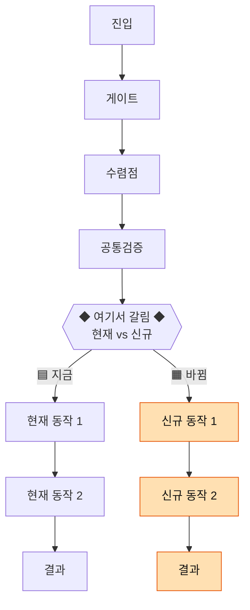

# 팬텀 플로우

> **코드를 보고 확실한 부분만 플로우로 그리고, 빈 공간은 🧐 로 표시해 개발자가 채우게 만드는** 작업 방식. 채워진 결과물은 정책 + 플로우의 정확성을 보장하고, 그 위에서 QA가 엣지를 조기 탐색하며, 최종적으로 AI가 자동화 테스트를 생성할 수 있다.
>
> 앞부분(목적~5단계)은 **방법론(What/Why)**, 뒷부분(실전 작성 순서~함정)은 **그릴 때 펼쳐보는 체크리스트(How)**. 새 플로우 분석은 "🛠️ 실전 작성 순서"부터 따라가면 여러 번 안 고치고 한 번에 나온다.

---
## 🎯 목적
1. **정책 + 플로우 정확성** — 코드로 확실한 사실 + 개발자가 채운 정책 = 진실의 단일 출처
2. **QA 엣지 조기 발견** — 🧐 로 표시된 미확정 분기가 곧 QA가 미리 탐색해야 할 엣지 후보
3. **AI 자동화 테스트 생성 가능** — 플로우와 정책이 명확하면 AI가 이를 기반으로 UI 테스트를 짤 수 있음

---
## 🧱 두 레이어 — 소스 플로우 ↔ 정책 QA

| | 📥 **소스 플로우** | ✅ **정책 QA** |
|---|---|---|
| 용어 | **코드 용어** (메서드·심볼) | **정책·사용자 용어** |
| 분리 기준 | 코드 영역(도메인) | 진입 × 분기축 → 결정테이블 → 케이스 ID |
| 보는 사람 | 개발자 | QA·기획 |
| 답하는 질문 | "지금 코드 이렇고 → 뭘 바꾸나"(AS-IS→TO-BE) | "어떤 상황이 어떤 동작"(케이스) |
| 단계 | 1단계 왁꾸 | 3~5단계 |
| 전제 | 정책 미확정 OK (🧐 허용) | **정책 확정돼야 가능** |

- **소스 플로우 → (🧐 채우기) → 정책 QA로 승격.** 둘은 같은 사실의 두 결.
- 정책 QA 본문은 정책 용어로 쓰고, **코드 심볼 ↔ 정책 용어 매핑표를 문서 맨 아래**에 둔다.
- 영역이 크면 **영역별 분리 + 허브**(범례·매트릭스·큰그림만). 영역 문서끼리 상단 네비로 상호 링크.

---
## 🎨 표기 규칙 (3색 + 🧐)

| 뱃지 | 의미 | 출처 |
|---|---|---|
| 🟦 **AS-IS** | 현행 동작 — **코드에서 확인됨** | 클라이언트 코드 |
| 🟧 **TO-BE** | 변경 예정 — **아직 코드에 없음** | Confluence·회의 |
| 🧐 | 미확정 (= QA 엣지 후보) | — |

- **mermaid**: 🟦 기본(흰색) / 🟧 주황 / 🧐 회색 점선
```
classDef tobe fill:#ffe0b2,stroke:#e65100,color:#111
classDef unsure fill:#eeeeee,stroke:#9e9e9e,stroke-dasharray:4 4,color:#111
```
- **본문**: 문장·항목 앞에 `🟦`/`🟧`/`🧐` 또는 `[AS-IS]`/`[TO-BE]`.
- 🧐 는 **플로우 위에 흩어 둔다** (mermaid 노드·체크리스트·표 셀). 별도 섹션에만 몰지 말 것.
- 본문 🧐 와 **미확정 항목 섹션은 1:1** 대응. 채워질 때 둘 다 동시 갱신.
- **클라이언트(우리 팀) 작업 범위 = 🟦 → 🟧 전환분.**

---
## 📐 핵심 정의
- **그리기 재료**: 클라이언트 코드 + UI 테스트 흐름
- **표현 단위**: 화면 전환·분기·조건 — **코드 인덱스(URL 나열, file:line 덤프)가 아님**
- **확실성 기준**:
	- 코드에서 **명확히 추적 가능한 흐름** → 본문에 박는다
	- 코드에서 **분기는 있는데 정책 의도가 불명확한 부분** → 🧐
	- 코드에 **없는 동작** → 미확정 항목으로 분리 + 본문에 🧐
- **이동·분기는 UI 기준**, **내부 조건은 코드 기준**

---
## 🚫 금지 / ✅ 허용

**금지:**
- 추측·가정으로 정책 단정
- "보통 이렇게 동작하니까" 도메인 패턴을 회사 정책인 양 박기
- **코드 인덱스 덤프** — 엔드포인트 URL 나열, file:line만 박는 식 (그건 별도 "현행 코드 분석" 노트)
- 코드로 확신 못 하는 분기를 단정해서 박는 것 — 그 자리엔 🧐 를 둔다
- **출처 없는 결합 단정** — 두 출처를 합친 추론은 명시 근거 없으면 🧐 (예: "회의의 단일토큰" + "설계의 Kotlin 서버"를 합친 구성)

**허용:**
- 코드에서 명확히 도출 가능한 화면 전환·분기·조건
- 코드 인용은 **각주·보조 형태**로 최소화 (본문은 플로우 자체)
- 정책 모호 분기는 🧐 + 미확정 항목 1:1 대응
- UI 테스트 함수와 케이스 ID 매핑

---
## 🪜 5 단계

### 1️⃣ 코드 + UI 테스트 흐름 기반 왁꾸
- 클라이언트 코드를 읽고 **확실한 화면 전환·분기·조건만** 플로우로 그린다
- 흐름 단위는 **UI 테스트가 따라가는 화면 이동**
- 내부 조건(에러 코드, 헤더, 응답 키 등)은 코드에서 가져온다
- **확신 못 하는 동작은 🧐** 로 표시하고 미확정 항목 섹션에 1:1 대응
- **4가지 틀**: ① mermaid 다이어그램 ② 진입별 체크리스트 ③ 교차 매트릭스(케이스 ID) ④ 미확정 항목

### 2️⃣ 개발자(사용자)가 🧐 채우기
- 1단계의 🧐 부분을 개발자가 정책으로 정정. 채워지면 🧐 → 동작 라벨로 교체, 미확정 항목 → 확정 이동
- **규칙**: 한 번에 한 분기. 사용자가 던지는 순서대로.

### 3️⃣ 추상화 (케이스 폭발 시)
- 분기·카디널리티가 폭발하면 **결정 테이블 모델** 도입: 응답 정규화 / 분류 코드(D1/D2/D3) / 카디널리티 / 우선순위 / 선택 UI 규칙
- QA가 새 엣지케이스 가져오면 결정 테이블에 올려서 흡수 가능한지 먼저

### 4️⃣ 단순화
- 동작 동일한 분류 통합, 불필요한 축 제거

### 5️⃣ 검증 + AI 자동화 테스트
- UI 테스트 함수와 케이스 ID 1:1 매핑 (`*UITests.swift`)
- **자동화 매핑 결과를 다시 보고** 빠진 케이스·잘못된 분기 발견 → 본문 보정 (역방향 추적)
- 완성된 플로우 + 정책 = **AI에게 입력으로 주면 자동화 테스트 생성 가능**

---
## 🛠️ 실전 작성 순서 (한 번에 그리기)

> 그릴 때 이 순서대로. 아래 순서를 어겨서 여러 번 재작업한 게 함정 표(맨 아래).

### ① AS-IS를 코드로 **먼저** 확정 — 절대 건너뛰지 말 것
- 진입 → 수렴점 → 실제 실행(네트워크·토큰·파일·외부 SDK)까지 코드로 추적.
- ⚠️ **"현재가 어떻게 도는지" 없이 TO-BE만 그리면 반드시 다시 그리게 된다.** (가장 흔한 재작업 원인)
- **전수 확인**: 코드 심볼은 `grep`으로 끝까지. import·`Frameworks/`·SDK까지 봐야 빠지지 않는다. (예: 인증 방식이 2개인 줄 알았는데 코드엔 3개)

### ② TO-BE를 Confluence·회의록 **전수** 검증
- 관련 설계 문서 + **회의록 전부** + 기획 문서를 읽고 대조.
- ⚠️ **설계 문서 ≠ 회의 결정**일 수 있다. (예: 설계는 `Download JWT`, 회의에서 `단일 토큰`으로 뒤집힘 — 설계 문서 최신본도 미반영)
- **최신 회의 결정이 우선.** 단 BE가 설계 문서만 볼 수 있으니 충돌 지점은 **⚠️ 경고 + 양쪽 출처 + "재확인 필수"**로 박는다.
- **출처(컨플 페이지 ID/링크)를 본문에 명시** — 나중에 추적·재검증 가능하게.

### ③ 분기형 한 장으로 그린다 — 공통 → 분기점 → 두 갈래
- 공통부(안 바뀌는 진입·게이트)는 한 줄기로, **바뀌는 지점에서 `◆ 분기점`**으로 🟦지금 / 🟧신규 두 갈래.
- ❌ **곁가지(점선으로 TO-BE 노드만 옆에 붙이기) 금지** — 따로 놀아서 안 보인다.
- ❌ **AS-IS 흐름도 / TO-BE 흐름도를 완전 별개 블록**으로 떼지 말 것 — "어디서 갈리는지"가 안 보인다.
- ✅ 복잡하면 대표 케이스(예: 일반도서) 기준으로 단순화하고, 나머지는 본문/주석으로.

### ④ 추측 금지 — 출처 없는 결합은 🧐
- 코드로 확실한 것만 단정. 두 출처를 합친 추론은 명시 출처 없으면 🧐. "보통 이러니까"는 회사 정책 아님.

### ⑤ 미확정 1:1 대응
- 본문 🧐 와 "미확정 항목" 섹션은 1:1. 채워지면 둘 다 동시 갱신.

---
## 🧭 표준 mermaid 템플릿 (분기형)


> 흐름선 = 🟦 현재 코드. 분기점◆ 위는 공통(안 바뀜), 아래에서 좌=지금 / 우=신규.

---
## 🔁 멀리 떨어진 노드로 위임 — 번호 라벨 + 안내 노드

같은 mermaid 안에서 "여기서 다른 흐름으로 위임 / 재진입" 을 표현할 때, **점선 화살표로 멀리 떨어진 노드까지 직접 연결하면 시각적으로 추적이 어렵다.** 화면 가로지르는 점선이 다른 분기와 겹치면서 "어디서 어디로 가는지" 가 안 보임. 대신 **번호 라벨 + 안내 노드** 패턴으로 분리.

**규칙:**
1. **종착 분기 노드에 섹션 번호 라벨** — 문서 섹션(`1️⃣ ~ 5️⃣` 등)과 mermaid 노드명을 일치시킴.
   - 예: `SK{2️⃣ 기존 연결 계정?}` / `SN{3️⃣ 기존 연결 계정?}` (`2️⃣ 카카오` / `3️⃣ 네이버` 섹션과 매핑)
2. **위임 표시는 parallelogram 안내 노드** — 점선 화살표 X.
   - 예: `D1 --> Restart[/"SDK 다른 계정 선택<br/>→ 2️⃣ 또는 3️⃣ 재진입"/]`
3. 다른 진입에서 같은 자리로 재위임되면 **같은 안내 노드로 수렴** (노드 ID 공유).

**효과:**
- "이 케이스는 ②번 분기로 다시 간다" 가 한 눈에 보임.
- mermaid 가 점선으로 cluttered 되지 않음.
- 별도 케이스 ID 폭증 방지 — 기존 분기로 흡수 표기.

**적용 신호:** "이 케이스는 다른 진입의 기존 흐름으로 그대로 흡수돼요" 같은 위임 정책이 확정됐을 때.

---
## ⚠️ 흔한 함정 (실제로 겪음 → 교정)

| 함정 | 교정 |
|---|---|
| TO-BE만 그려서 "현재가 안 보임" | AS-IS 먼저, **흐름선 = AS-IS** |
| TO-BE를 곁가지로 붙여 산만 | **분기점◆에서 두 갈래** |
| 수렴 이후만 따로 떼서 분기점 실종 | 공통→분기점→두 갈래 **한 그림** |
| 코드 안 보고 개수 단정 (인증 방식 2개?) | grep 전수 (import·Frameworks 포함) → 실제 3개 |
| 설계 문서만 보고 TO-BE 확정 | **회의록 전수**, 설계≠회의 충돌 경고 |
| 코드 용어로 노드 단정 | 출처 없는 결합은 🧐, BE 재확인 |
| 위임/재진입을 점선 화살표로 멀리 노드까지 끌고 감 (추적 ↓) | **번호 라벨 + 안내 노드** 분리 (`[/X 재진입/]` parallelogram), 종착 노드에 섹션 번호 박기 |

---
## 📐 표준 산출물 구조

```
🧭 <프로젝트> 플로우 (허브: 범례·데일리반영·큰그림·매트릭스·공통 미확정)
├── <영역> 소스 플로우 (📥 등) — 분기형 흐름도 + AS-IS 실제 호출 + 변경점 대조표 + 미확정
└── ✅ <영역> QA (정책 승격 후) — 진입×권한 결정테이블 + 케이스 ID + 자동화 매핑 + 소스 매핑
```

**영역 문서(소스) 내부:**
```markdown
## 🧭 흐름 (분기형 mermaid)
## N-0. 일정·배포 전략 (회의 검증)
## N-1. 진입 / 게이트 (AS-IS 코드)
## N-x. AS-IS 실제 호출 순서 (sequenceDiagram)
## N-x. 변경점 대조 (AS-IS → TO-BE → 내 작업) 표
## 📌 미확정 항목 (= QA 엣지 후보, 본문 🧐 와 1:1)
```

---
## 🏷️ 케이스 ID 명명 규칙

`{진입}{단계}{결과}{분류}{카디널리티}`

- **진입(1자)**: 첫 글자 — M(자사) / K(카카오) / N(네이버) / A(애플) / G(구글) / (다운로드) W(화면)·L(링크)·E(회차)·V(상세)
- **단계**: PF(패스 실패) / EX(기존 회원) / N-U(미가입·14세 미만) / N-AD(미가입·성인) / LI(즉시 로그인) 등
- **결과**: -S(성공) / -F(실패) / 생략(단일 결과)
- **분류**: D1 / D2 / D3 등 결정 테이블 분류 코드
- **카디널리티**: -S 접미사 = 복수 선택 UI (S는 Selection)

**예시:** `K-LI`(카카오 즉시 로그인) · `K-EX-D2S`(카카오·기존회원·D2·선택UI) · `A-KR-N-AD-F`(애플·내국인·미가입·성인·실패) · `W-E1`(화면 다운로드·이메일 미인증)

---
## ⚖️ 역할 분담

| 단계 | Claude | 사용자(개발자) |
|---|---|---|
| 1. 왁꾸 | ✅ 코드 + UI 테스트 흐름 읽고 확실한 부분 그리기 / 🧐 표시 | 영역·범위 지정 |
| 2. 🧐 채우기 | 받아 적기 | ✅ 정책 정정·확정 |
| 3. 추상화 | ✅ 결정 테이블 모델 제안 | 정책 검증 |
| 4. 단순화 | 후속 갱신 | ✅ 합칠 부분 지정 |
| 5. 검증 + 자동화 | ✅ 매핑·표 / AI 테스트 생성 위한 입력 정리 | 통과/실패 체크 |

**원칙:** Claude는 코드로 확실한 부분을 그리고 모호한 부분을 🧐 로 비워둔다. **추측해서 채우지 않는다.** 사용자가 🧐 를 정확한 정책으로 메우면서 문서가 완성된다.

---
## 🚦 신호와 대응

| QA/기획에서 들어오는 신호 | 의미 | 대응 |
|---|---|---|
| "엣지케이스 계속 나옴" | 정책이 안 정해져서 QA가 변형을 다 가져옴 | 결정 테이블 모델 도입 (3단계) |
| "이건 어떻게 처리해요?" 연속 | 미확정 항목들 | 한 번에 회의로 모아 해소 |
| "X 케이스는 처리 가능?" | 새 분류 또는 카디널리티 변형 | 결정 테이블에 올려 흡수 가능한지 |
| "Y 동작이 Z 동작과 같지 않아?" | 분류 통합 가능 신호 | 4단계 단순화 |
| 자동화 테스트가 케이스 매핑이 안 됨 | 플로우/정책에 누락 분기 존재 | UI 테스트 → 플로우 역방향 추적 (5단계) |

---
## 📎 적용 사례
- [[✅ SNS로그인 QA|SNS로그인 QA]] — 진입 5종 × 분기 × 카디널리티 = 43 케이스를 D1/D2/D3 + S로 압축. UI 테스트 43개와 1:1 매핑됨. **정책 플로우 완성형.**
- [[📥 상품 아키텍처 다운로드|상품 아키텍처 다운로드 (소스)]] — 분기형(◆) + AS-IS 호출순서 + 변경점 대조 + 컨플 전수 검증(설계≠회의)
- [[✅ 상품 아키텍처 다운로드 QA|상품 아키텍처 다운로드 QA (정책)]] — 진입×권한 결정테이블 + 케이스 ID
- [[🧭 상품 아키텍처 플로우|상품 아키텍처 플로우 허브]] — 4 영역(결제/다운로드/읽기/정산) 분리 + 허브
